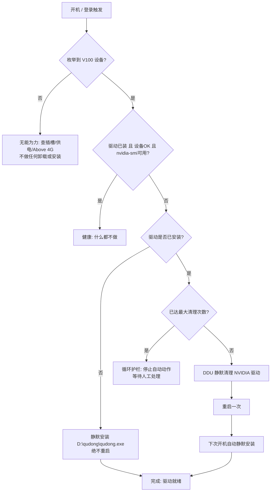

# V100 驱动自动重装 / 自愈工具

> 解决 Tesla V100（消费级主板 + Windows Data Center Driver + WSL2）**掉驱动**问题的开机自愈方案。
> 检测到驱动丢失或损坏 → 静默清理 →（重启一次）→ 静默重装 → 全程不手动干预。

---

## 一、背景：V100 为什么会「掉驱动」

作者在自组台式机上部署了 **Tesla V100-PCIE-32GB（华为 OEM）** 用于 AI 训练，硬件环境如下：

| 部件 | 型号 |
| --- | --- |
| 主板 | ASUS PRIME H610M-K D4（消费级，BIOS 较旧） |
| CPU | Intel i5-12400 |
| 电源 | 650W |
| 内存 | 16GB |
| GPU | Tesla V100-PCIE-32GB（华为 OEM，无视频输出） |
| 系统 | Windows 10 + WSL2(Ubuntu) + NVIDIA Data Center Driver |
| 用途 | llama.cpp 本地推理 / AI 训练 |

在这个组合下，V100 会**间歇性掉驱动**，典型表现：

- 设备管理器里 V100 带黄色感叹号，问题码常见 `43` / `10` / `STATUS_INSUFFICIENT_RESOURCES`（本质是 PCIe BAR 资源分配失败）；
- `nvidia-smi` 报错 `Unable to communicate with the NVIDIA driver`；
- WSL2 内的 CUDA 不可用，训练/推理任务直接失败；
- **最隐蔽的一种**：llama.cpp 的 `llama-server` 在 CUDA 初始化失败时**不报错，而是静默回退 CPU**，实测速度从 GPU 上的 **110+ tok/s** 暴跌到 **0.745 tok/s**，双击启动脚本后肉眼完全看不出来——服务「在跑」，只是跑在了 CPU 上。

### 为什么会掉

消费级主板 + 数据中心计算卡的「错配」是根因，常见诱因：

1. **PCIe BAR / Above 4G Decoding / ReBAR**：V100 32GB 需要较大的 64-bit PCIe BAR，老消费级主板的 Above 4G Decoding 没开、或 ReBAR 兼容性差，导致上电时 BAR 分配失败，驱动加载后设备不可用；
2. **Windows Update 偷偷换驱动**：Windows 可能把 Data Center Driver 换成自带的「基本显示适配器」或旧版 WHQL 驱动，造成版本错乱、驱动残留；
3. **驱动处于半安装 / 损坏状态**：崩溃、强制断电、安装中断后，注册表和驱动仓库里留下脏数据，单纯「再装一次」往往装不上；
4. **Data Center Driver 与 WSL2 的交互**：WDDM / WSL 显示驱动与计算驱动共存时的状态不一致。

> 本工具是** workaround（权宜之计）**：它不能修好主板 BIOS 的 BAR 分配缺陷，但能把「掉驱动 → 人工插手 → 重装 → 重启」压缩成一次无人值守的自动恢复，让你不必每次都爬起来手动搞。

---

## 二、解决方案总览

工具是一个 **看门狗（watchdog）**，以 Windows 计划任务的形式在**开机**和**登录**时运行，逻辑如下：

1. **探测状态**：V100 设备是否被枚举到？NVIDIA 驱动是否安装？`nvidia-smi` 是否可用？
2. **无驱动** → 直接进入**静默安装**（装完**绝不重启**）；
3. **驱动在但设备不可用** → 用 **DDU（Display Driver Uninstaller）静默清理** → **重启一次** → 下次开机自动**静默安装** → 装完**绝不重启**；
4. **一切正常** → 什么都不做，直接退出。

### 设计上的关键取舍

- **只在 DDU 清理后重启一次**，装完驱动后**绝不主动重启**——避免「装完又重启、重启又没好」的死循环，也不打扰你正在干的事；
- **状态机 + 循环护栏（MaxCleanTry）**：最多自动清理+重启 `2` 次，超过就停止并等待人工处理，防止无限重启；
- **锁文件（running.lock）**：防止计划任务并发重入；
- **干跑模式（dryrun）**：只判断「会做什么」，完全不碰系统，先验证流程再真跑；
- **中文 UTF-8 源 + bat 转 UTF-16**：绕开 Windows PowerShell 5.1 读中文脚本乱码的问题；
- **计划任务以 SYSTEM 身份开机运行**，同时注册一个「登录时」任务兜底——因为 DDU 在纯 SYSTEM 会话下偶尔会被弹窗卡住，登录任务能补跑一轮。

---

## 三、工作流（状态机）



---

## 四、文件说明

| 文件 | 作用 |
| --- | --- |
| `scripts/_v100_auto_core.ps1` | **核心引擎**。状态机、DDU 清理、静默安装、计划任务注册/注销、状态查询、干跑。 |
| `scripts/V100驱动自动重装.bat` | **入口**。请求管理员权限 → 把 ps1 转 UTF-16（防中文乱码）→ 运行核心菜单。 |
| `scripts/启动模型和frp.bat` | 一键启动 llama.cpp 模型服务 + frp 公网隧道，并带 **V100 自检**（检测到模型回落 CPU 时自动重启）。 |
| `scripts/checkmodel.bat` | 查看 / 切换当前在跑的 llama.cpp 模型，显示对外 API 别名。 |

> `_v100_auto_core.ps1` 与 `V100驱动自动重装.bat` 必须放在**同一目录**（bat 用 `%~dp0` 找 ps1）。

---

## 五、安装与配置

### 前置条件

1. Windows 10/11，且拥有管理员权限；
2. 已安装 **[DDU (Display Driver Uninstaller)](https://www.guru3d.com/files-details/display-driver-uninstaller-download.html)**，默认路径 `C:\Program Files\Display Driver Uninstaller\Display Driver Uninstaller.exe`；
3. 已下载好 **NVIDIA Data Center Driver** 安装包（本文称 `qudong.exe`），放在固定路径，例如 `D:\qudong\qudong.exe`；
4. PowerShell 5.1（Windows 自带，无需额外安装；脚本以 `-ExecutionPolicy Bypass` 运行，不要求改系统策略）。

### 修改配置（必做）

打开 `scripts/_v100_auto_core.ps1`，修改顶部 `$Cfg` 块里的路径为你机器的实际位置：

```powershell
$Cfg = @{
    DduExe      = 'C:\Program Files\Display Driver Uninstaller\Display Driver Uninstaller.exe'
    DriverExe   = 'D:\qudong\qudong.exe'   # ← 改成你的驱动包路径
    WorkDir     = 'C:\ProgramData\V100Auto'
    BootWaitSec = 120                       # 开机后延迟多久跑检测
    MaxCleanTry = 2                         # 自动清理+重启的最大次数（防无限重启）
    AutoReboot  = $true                     # DDU 后是否自动重启；$false 则改手动推进
    # ...
}
```

`启动模型和frp.bat` 与 `checkmodel.bat` 里也有若干**写死的用户路径**（`D:\llamacpp\...`、`D:\qudong\...`、frp 公网地址等），发布版本为作者本机配置，他人使用前请按注释自行调整。

---

## 六、使用

### 方式一：菜单（手动）

右键 **`V100驱动自动重装.bat` → 以管理员身份运行**，出现菜单：

```
  [1] 立即跑一轮状态机（先手动验证整个流程，推荐）
  [2] 干跑：只看它会做什么
  [3] 注册/更新计划任务（开机 + 登录）
  [4] 删除计划任务
  [5] 查看状态 + 任务 + 日志
  [6] 单独测试 DDU 静默清理（真的会卸掉驱动）
  [7] 单独测试静默安装驱动
  [8] 复位清理/重启计数
  [Q] 退出
```

推荐顺序：先 `[2]` 干跑看它打算做什么 → 再 `[1]` 实跑一轮 → 确认 OK 后 `[3]` 注册计划任务实现开机自愈。

### 方式二：命令行（适合计划任务 / 脚本调用）

```powershell
# 跑一轮检测+修复（计划任务实际执行的命令）
powershell -NoProfile -ExecutionPolicy Bypass -File "_v100_auto_core.ps1" -Action cycle

# 只判断不动作
powershell -NoProfile -ExecutionPolicy Bypass -File "_v100_auto_core.ps1" -Action dryrun

# 注册 / 注销计划任务
powershell -NoProfile -ExecutionPolicy Bypass -File "_v100_auto_core.ps1" -Action register
powershell -NoProfile -ExecutionPolicy Bypass -File "_v100_auto_core.ps1" -Action unregister

# 查看状态、日志
powershell -NoProfile -ExecutionPolicy Bypass -File "_v100_auto_core.ps1" -Action status
```

### 开机自愈（最终目标）

注册计划任务后，系统会在**开机延迟 120 秒**和**你登录时**各触发一次 `cycle`。此后只要 V100 掉驱动，重启机器即可在无人值守的情况下自动恢复——这正是解决「掉驱动」的核心价值。

---

## 七、日志与状态

- 日志：`C:\ProgramData\V100Auto\v100auto.log`（每次运行追加，菜单 `[5]` 可看最近 30 行）；
- 状态：`C:\ProgramData\V100Auto\state.json`（`Phase` / `CleanCount` / `LastOk` / `LastResult`）；
- 锁文件：`C:\ProgramData\V100Auto\running.lock`（防止并发重入，正常退出即删除）。

`state.json` 字段含义：

| 字段 | 说明 |
| --- | --- |
| `Phase` | `none` / `ok` / `installing` / `cleaning` / `awaiting-install` / `idle` |
| `CleanCount` | 已自动清理+重启的次数（达 `MaxCleanTry` 后触发护栏） |
| `LastOk` | 最近一次驱动健康的时间 |
| `LastResult` | `healthy` / `installed-ok` / `install-failed` / `cleaned-await-install` / `gpu-missing` / `loop-guard` 等 |

---

## 八、模型启动脚本里的 V100 自检（为什么需要）

`启动模型和frp.bat` 并非驱动修复工具，而是解决「**驱动没掉，但模型悄悄跑在了 CPU 上**」这一更隐蔽的问题。

`llama-server` 在 CUDA 初始化失败时不报错、不退出，而是回退 CPU。脚本通过读取 **V100 显存占用** 判断服务到底跑在哪：

- 显存占用 ≥ 1 万 MiB → 确实在卡上，正常；
- 8080 端口有服务、但显存几乎为 0 → 说明它回退到了 CPU，脚本会**杀掉并重启** `llama-server`，直到它真正上卡。

> 实现细节：读显存走临时文件 + 纯数字校验，不能写成 `for /f (... 2^>nul)`，否则本机实测 `nvidia-smi` 会把 `2>nul` 当参数吐 `ERROR:`，导致误判成「没上卡」把正常服务杀掉。这个坑已经踩过并修掉了。

---

## 九、注意事项与局限

- **这是 workaround，不是根治**：根因通常在主板 BIOS 的 Above 4G Decoding / ReBAR。能开就开，能更新主板 BIOS 就更新，能换设备树更干净的插槽就换——比任何脚本都治本。
- **路径是用户相关的**：脚本里的 `D:\qudong\`、`D:\llamacpp\`、frp 公网 IP 都是作者本机配置，他人使用前务必改。
- **DDU 会清掉所有 NVIDIA 驱动**：包括你可能有的游戏卡驱动，本机只有 V100 时没问题。
- **自动重启默认开启**：`AutoReboot=$true` 时 DDU 后会真的重启机器。介意就设为 `$false`，改由菜单 `[1]` 手动推进。
- **华为 OEM V100 固件 quirks**：部分华为 OEM 卡固件对 BAR 要求较怪，必要时可尝试在设备管理器里对 V100 手动「禁用再启用」作为补充手段。
- **不与手动安装冲突**：状态机检测到「健康」就直接退出，不会重复装驱动。

---

## 十、故障排查

| 现象 | 排查 |
| --- | --- |
| 菜单中文乱码 | 确认用 `V100驱动自动重装.bat` 入口（它负责转 UTF-16）；不要直接用 `powershell .\xxx.ps1` 跑 UTF-8 源 |
| DDU 卡住不动 | 纯 SYSTEM 会话下 DDU 可能被弹窗阻塞；等登录任务补跑，或手动跑菜单 `[6]` 验证 |
| 装完驱动仍不可用 | 看 `v100auto.log` 末段；多半是 BIOS BAR / 插槽问题，脚本已尽力，需从硬件层解决 |
| 无限重启 | 不可能——`MaxCleanTry` 护栏会拦截；若真出现，说明 `state.json` 被外部改动，菜单 `[8]` 复位 |
| 模型速度异常慢 | 用 `checkmodel.bat` 看跑在哪个模型；用 `启动模型和frp.bat` 的自检确认是否上卡 |

---

## 十一、许可证

[MIT](LICENSE) © zcstudy。随意使用、修改、再分发，作者不对因使用本工具导致的任何数据丢失或系统异常负责（自动重装驱动前请自行备份重要状态）。
